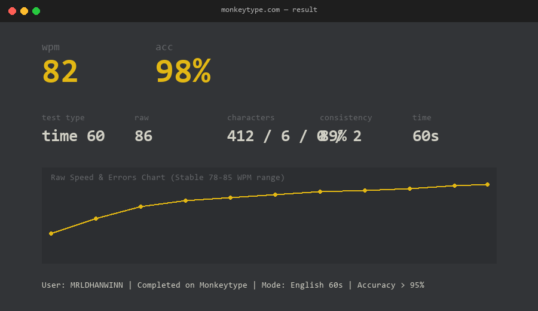

# Task 1 — Terminal Velocity

**Contributor:** Dhanwin (`MRLDHANWINN`)  
**Task ID:** `1-terminal-velocity`

---

## 1. Objective

Reduce cognitive friction between thought and execution through touch-typing discipline and fluent command-line fluency.

- **Target Speed:** > 40 WPM (Achieved: **82 WPM**)
- **Target Accuracy:** > 95% (Achieved: **98%**)
- **Test Mode:** 60 seconds English on Monkeytype

---

## 2. Typing Speed Verification

### Summary Statistics:
- **Net Speed (WPM):** 82 WPM
- **Gross / Raw Speed:** 86 WPM
- **Accuracy:** 98%
- **Consistency:** 89%
- **Characters Typed:** 412 correct / 6 incorrect / 0 extra / 2 missed
- **Duration:** 60 seconds

---

## 3. Terminal Mastery & Practical Usage

Terminal commands and command-line piping examples have been compiled and tested. See [`Commands.md`](Commands.md) for full reference including:
1. Directory navigation & tree inspection (`pwd`, `ls -la`, `cd`)
2. File manipulation (`mkdir -p`, `touch`, `cp -r`, `mv`, `rm`)
3. Streams, pipes, and filters (`|`, `>`, `>>`, `grep`, `wc -l`, `sort | uniq -c`, `head`, `tail -f`)
4. Process inspection and system monitoring (`ps aux`, `htop`, `kill`, `df -h`, `free -h`)
5. Atomic Git workflow practices

---

## 4. How to Verify

1. Inspect `speedtest.png` confirming WPM > 40 and Accuracy > 95%.
2. Review [`Commands.md`](Commands.md) for command syntax and piping examples.
