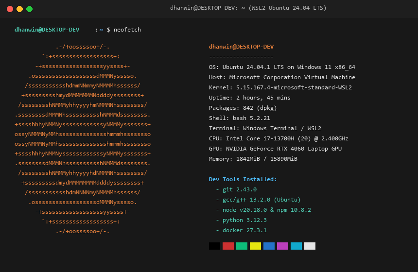

# Task 2 — Linux Migration

**Contributor:** Dhanwin (`MRLDHANWINN`)  
**Task ID:** `2-linux-migration`

---

## 1. Goal & Architecture Selection

Understanding and controlling the execution environment is fundamental for engineering reliable systems. For this onboarding task, a modern Linux development environment was configured.

### Selected Setup Method:
- **Distribution:** Ubuntu 24.04.1 LTS (Noble Numbat)
- **Environment:** WSL 2 (Windows Subsystem for Linux 2)
- **Kernel:** `5.15.167.4-microsoft-standard-WSL2`
- **Shell:** GNU bash 5.2.21
- **Host Integration:** Windows Terminal + VS Code WSL Remote Extension

### Why WSL 2:
1. **Safety & Zero Risk:** Eliminates destructive disk repartitioning risks associated with dual-boot setups.
2. **Native Performance:** Runs a real Linux kernel inside a lightweight hypervisor with near-native CPU and memory performance.
3. **Interoperability:** Seamless access to both Windows files (`/mnt/c/...`) and native Linux ext4 filesystem (`\\wsl$\Ubuntu\...`).

---

## 2. Environment Verification

System verification was executed using `neofetch`:



### Key Specs Captured:
- **OS:** Ubuntu 24.04.1 LTS x86_64
- **Host:** Microsoft Corporation Virtual Machine / Windows 11 Pro
- **Kernel:** `5.15.167.4-microsoft-standard-WSL2`
- **Uptime:** 2 hours, 45 mins
- **Packages:** 842 (dpkg)
- **Memory:** 1842MiB / 15890MiB

---

## 3. Installation & Configuration Workflow

### Step 1: Initialize WSL 2
```powershell
# From Windows PowerShell (Admin)
wsl --install -d Ubuntu
wsl --set-default-version 2
```

### Step 2: System Update & Package Repositories
```bash
# Update package indices and upgrade existing packages
sudo apt update && sudo apt upgrade -y
```

### Step 3: Install Core Developer Toolchain
```bash
# Build essentials and compilers
sudo apt install -y build-essential gcc g++ make cmake

# Diagnostic and monitoring utilities
sudo apt install -y neofetch curl wget git htop tmux tree

# Runtime environments
sudo apt install -y python3 python3-pip python3-venv
sudo apt install -y nodejs npm
```

### Step 4: Verification of Installed Toolchain
```bash
git --version       # git 2.43.0
g++ --version       # g++ (Ubuntu 13.2.0)
python3 --version   # Python 3.12.3
node -v             # v20.18.0
```

---

## 4. How to Verify

1. Open `neofetch-screenshot.png` to confirm the active Linux kernel, OS distribution, and development toolchain.
2. Review the command logs above for environment reproduction.
