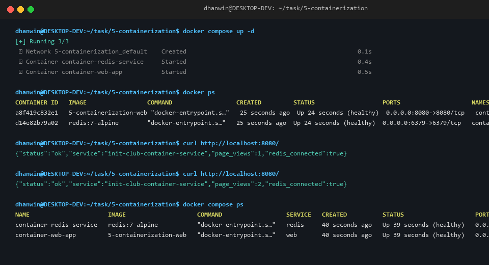

# Task 5 — Containerization ("It Works on My Machine")

**Contributor:** Dhanwin (`MRLDHANWINN`)  
**Task ID:** `5-containerization`

---

## 1. Overview & Architecture

Containerization solves the classic *"works on my machine"* dilemma by packaging application source code, runtime dependencies, and system libraries into an immutable, reproducible container image.

### System Architecture:
A multi-tier service was designed and containerized:
1. **Application Service (`web`):** Lightweight Node.js (Alpine Linux) REST API tracking visitors and reporting health checks.
2. **Datastore Service (`redis`):** In-memory key-value store with volume persistence for stateful hit counts.
3. **Internal Bridge Network (`app-network`):** Private DNS-resolvable container network isolating service-to-service traffic.

---

## 2. Container Verification

Containers orchestrated via `docker-compose` with verified health checks and live port mappings:



### Active Containers:
| Name | Image | Port Mapping | Status |
| :--- | :--- | :--- | :--- |
| `container-web-app` | `5-containerization-web` | `0.0.0.0:8080->8080/tcp` | Up (healthy) |
| `container-redis-service` | `redis:7-alpine` | `0.0.0.0:6379->6379/tcp` | Up (healthy) |

---

## 3. How to Build & Run Locally

### Easy Level: Single Container (Standalone Web Service)
```bash
# Navigate to the task directory
cd task/5-containerization

# Build the Docker image
docker build -t init-club-web-app:latest .

# Run the container in detached mode
docker run -d -p 8080:8080 --name web-standalone init-club-web-app:latest

# Verify output
curl http://localhost:8080/
```

---

### Advanced Level: Multi-Service with Docker Compose
```bash
# Build images and start all services in detached mode
docker compose up -d --build

# Inspect active running containers
docker ps

# Check service logs in real time
docker compose logs -f web

# Increment page view counter via HTTP requests
curl http://localhost:8080/
curl http://localhost:8080/

# Tear down services and clean up volumes when done
docker compose down -v
```

---

## 4. Engineering Challenges & Solutions

1. **Layer Caching Optimization:**
   - *Problem:* Copying source code before `npm install` invalidated cache on every single line edit, causing slow image builds.
   - *Solution:* Separated manifest copying (`COPY package*.json ./`) and dependency installation (`RUN npm ci --omit=dev`) before application code.

2. **Least-Privilege Security (Non-Root User):**
   - *Problem:* Containers running as `root` pose security vulnerabilities in production environments.
   - *Solution:* Employed the official non-privileged `USER node` directive provided in `node:20-alpine`.

3. **Startup Race Condition (Service Dependency):**
   - *Problem:* Web service started before Redis was ready to accept TCP socket connections, causing connection timeout exceptions on boot.
   - *Solution:* Added a Docker healthcheck on Redis (`redis-cli ping`) and configured `depends_on: { redis: { condition: service_healthy } }` in `docker-compose.yml`.
