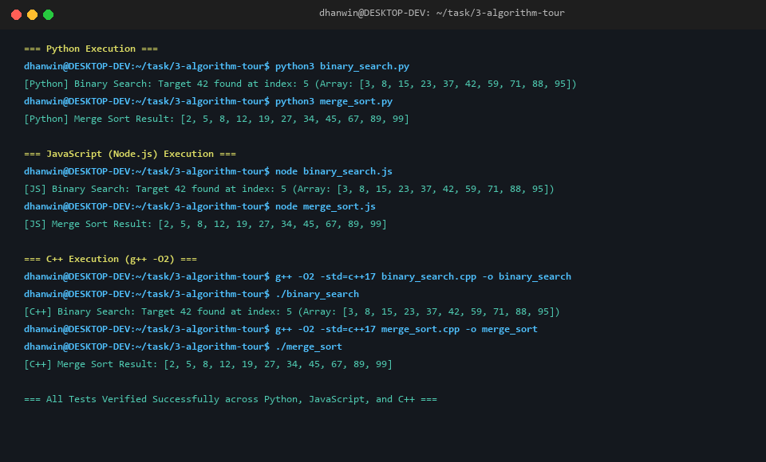

# Task 3 — Algorithm Tour (Advanced Level)

**Contributor:** Dhanwin (`miriyaladhanwinn`)  
**Task ID:** `3-algorithm-tour`

---

## 1. Overview

This task explores how identical algorithmic paradigms—**Binary Search** ($O(\log n)$) and **Merge Sort** ($O(n \log n)$)—are expressed, constrained, and reasoned about across three distinct execution environments:
1. **Python 3** (Dynamic, interpreted, garbage-collected)
2. **JavaScript / Node.js** (Dynamic, prototype-based, V8 JIT-compiled event-loop engine)
3. **C++ (C++17)** (Static, compiled, native memory management with RAII)

---

## 2. Test Execution & Verification

All implementations include self-contained assertion drivers verifying base cases, single elements, odd/even lists, reversed arrays, and empty lists.

Refer to [`usage.txt`](usage.txt) for copy-pasteable execution and compilation instructions.

---

## 3. Cross-Language Comparative Analysis

### A. Control Flow and Expressiveness

| Dimension | Python | JavaScript | C++ |
| :--- | :--- | :--- | :--- |
| **Brevity & Readability** | Highest. Pythonic list slicing (`arr[:mid]`) and dynamic typing make code succinct. | Moderate. Array methods (`slice()`, `push()`) provide clean functional constructs. | Verbose. Explicit iterator ranges, indices, vector allocations, and loop counters. |
| **Midpoint Computation** | `mid = low + (high - low) // 2` (Integer division operator `//` prevents floats). | `(low + high) >>> 1` (Bitwise unsigned shift truncates to integer and prevents overflow). | `mid = low + (high - low) / 2` (Typed integer division without overflow). |
| **Array Slicing** | Slicing creates shallow copied sublists automatically. | `slice(start, end)` creates shallow array copies. | Slicing is manual; usually avoided by passing reference indices `left, right` to prevent vector reallocation. |

---

### B. Memory Usage Patterns

1. **Python:**
   - Everything is an object (`PyObject`). An integer list is an array of pointers to `int` objects.
   - Recursive list slicing (`arr[:mid]`) allocates new sublists on the private Python heap at each recursion frame ($O(n \log n)$ total transient memory allocations).
   - Memory is managed via reference counting and a cyclic garbage collector.

2. **JavaScript (V8):**
   - V8 optimizes contiguous arrays using packed SMI (Small Integer) representations.
   - `slice()` copies array elements into newly allocated heap objects.
   - Generational Garbage Collector (Scavenge for young generation, Mark-Sweep-Compact for old generation) reclaims temporary sub-arrays.

3. **C++ (Native RAII):**
   - In C++, the input vector is passed by reference `std::vector<int>& arr`.
   - The recursive function operates in-place using boundary indices `[left, right]`.
   - Auxiliary storage is only allocated during the merge step (`vector<int> L(n1)`, `vector<int> R(n2)`), directly on heap or stack. Memory is deterministically freed as soon as `merge()` scope exits (zero GC pauses).

---

### C. Error Handling and Safety Guarantees

1. **Type Safety & Bounds:**
   - **C++:** Strict static typing. Out-of-bounds indexing via `operator[]` exhibits undefined behavior (or throws `std::out_of_range` if `arr.at()` is used). Compile-time type checking prevents mismatched comparisons.
   - **JavaScript:** Permissive dynamic typing. Out-of-bounds access silently evaluates to `undefined`, which can propagate subtle logical bugs downstream (e.g. `undefined <= 5` evaluates to `false`).
   - **Python:** Strongly typed dynamic system. Out-of-bounds access immediately raises an explicit `IndexError`. Type errors during comparison raise `TypeError`.

2. **Integer Overflow:**
   - In C++, standard integer addition `(low + high)` could overflow 32-bit signed integers if array sizes exceed $2^{30}$. This is safeguarded by using `low + (high - low) / 2`.
   - In Python 3, integers have arbitrary precision (bignums), eliminating arithmetic overflow.
   - In JavaScript, numbers are IEEE 754 double-precision floats; `(low + high) >>> 1` treats operands as 32-bit unsigned integers.

---

### D. Debugging Experience

1. **Python:**
   - Highly interactive debugging with Python's built-in debugger (`breakpoint()` / `pdb`).
   - Inspect variables in an interactive REPL at any stack frame.
   - Exception tracebacks provide exact file, line, and code context.

2. **JavaScript:**
   - Rich debugging via `node --inspect-brk` hooked into Chrome DevTools or VS Code debugger.
   - Call stack, closures, and heap snapshots can be inspected interactively with live watch expressions.

3. **C++:**
   - Debugged using GDB or LLDB with `-g` debug symbols (`g++ -g merge_sort.cpp -o debug_sort`).
   - Enables examination of raw registers, pointer addresses, and memory disassemblies.
   - Sanitizers (`-fsanitize=address,undefined`) catch off-by-one errors and memory leaks at runtime.

---

## 4. File Manifest

- [`binary_search.py`](binary_search.py) — Python implementation
- [`merge_sort.py`](merge_sort.py) — Python implementation
- [`binary_search.js`](binary_search.js) — JavaScript implementation
- [`merge_sort.js`](merge_sort.js) — JavaScript implementation
- [`binary_search.cpp`](binary_search.cpp) — C++ implementation
- [`merge_sort.cpp`](merge_sort.cpp) — C++ implementation
- [`usage.txt`](usage.txt) — Execution instructions
- [`algo_output.png`](algo_output.png) — Terminal execution screenshot
